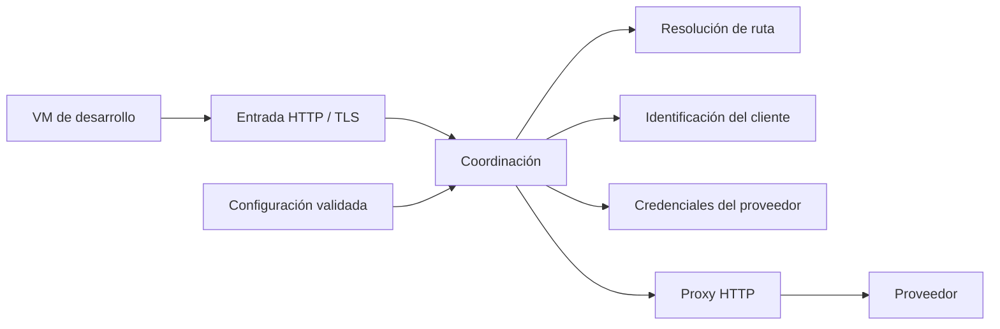

# Arquitectura

El gateway es la frontera entre las VMs de desarrollo y los proveedores. Las VMs guardan únicamente un token revocable del gateway. Las credenciales reales permanecen en el servidor y solo se envían al proveedor correspondiente.

## Flujo de una petición

El gateway resuelve una ruta permitida, identifica al cliente y obtiene la credencial que exige esa ruta. Después sustituye las cabeceras de autenticación y reenvía la petición. Una petición sin ruta, identidad o credencial válida termina antes de contactar con el proveedor.

## Responsabilidades

- **Configuración:** leer y almacenar una copia validada de clientes y rutas. La validación del formato está separada del acceso al fichero. Cada petición utiliza una misma copia para todas sus decisiones.
- **Router:** seleccionar la primera ruta que coincida con el path y construir el destino. Las rutas describen coincidencias exactas, por prefijo o por expresión regular, y las transformaciones del path.
- **Autenticación:** extraer el token del gateway e identificar al cliente mediante su hash. La consulta utiliza un índice en memoria.
- **Credenciales:** interpretar la política de la ruta para construir las cabeceras del proveedor. Los tipos de autenticación son mecanismos generales, independientes del nombre del proveedor.
- **Handler:** coordinar los pasos, responder errores y preparar la petición para el proxy. Los demás módulos devuelven resultados o errores sin finalizar la petición HTTP.
- **OpenResty:** terminar TLS y transportar las peticiones y respuestas, con soporte de streaming. El health check es independiente de los proveedores.

## Decisiones y límites

- Se utiliza un único dominio y rutas por path. Los destinos proceden exclusivamente de la configuración del servidor.
- Identificar al cliente y autenticarse ante el proveedor son operaciones distintas. El desafío HTTP que solicita credenciales al cliente pertenece a la primera; Basic o Bearer hacia el proveedor pertenece a la segunda.
- Una ruta referencia una credencial por su nombre dentro del cliente. Si falta, el acceso se deniega.
- Las rutas se evalúan en orden. Los prefijos respetan límites de segmento y las transformaciones conservan la query. Se rechazan las representaciones del path que no se pueden transformar de forma segura.
- La configuración se carga al arrancar y se recarga con las peticiones, como máximo una vez por `CONFIG_TTL`. Un bloqueo compartido serializa las recargas. El documento validado se publica atómicamente en `lua_shared_dict gateway_config` (10 MiB), sin caducidad; los errores de lectura, validación o capacidad conservan la última copia válida. Cada worker consulta el documento compartido por petición y reconstruye su copia local solo cuando cambia. Las copias se tratan como datos de solo lectura. La memoria compartida sobrevive a recargas de Nginx, pero no a un reinicio completo; si no existe ninguna copia válida, se responde 503.
- Las credenciales y las cabeceras de autenticación no se escriben en los logs. Las cabeceras de autenticación del cliente se eliminan antes de aplicar las del proveedor.
- Las pruebas usan proveedores simulados y credenciales falsas. Ejercitan tanto los módulos como las peticiones HTTP y las operaciones Git completas.
